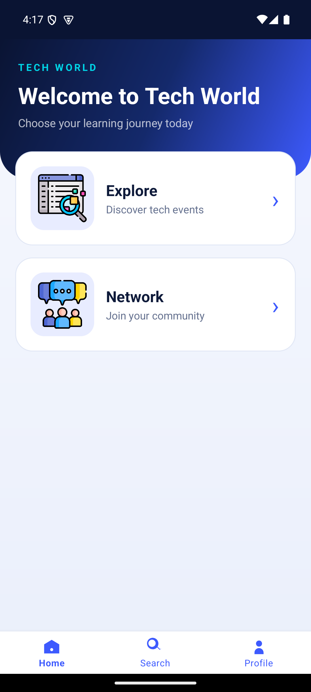
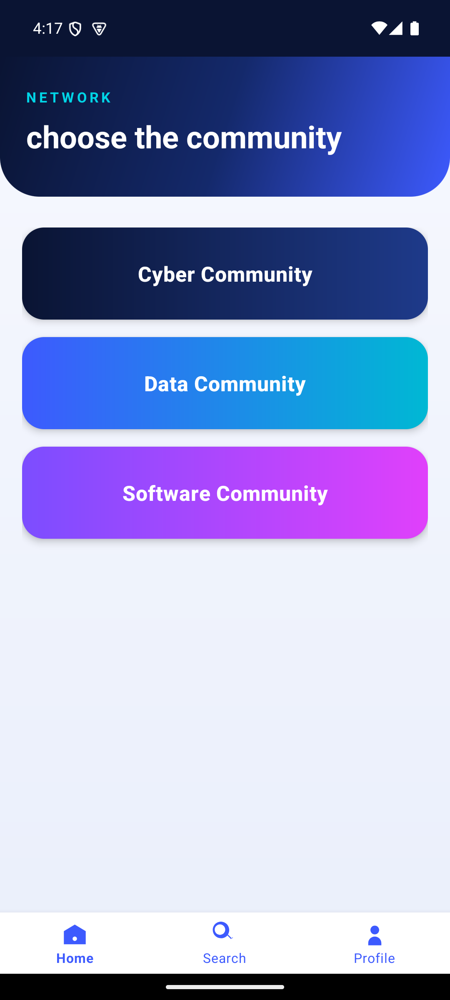
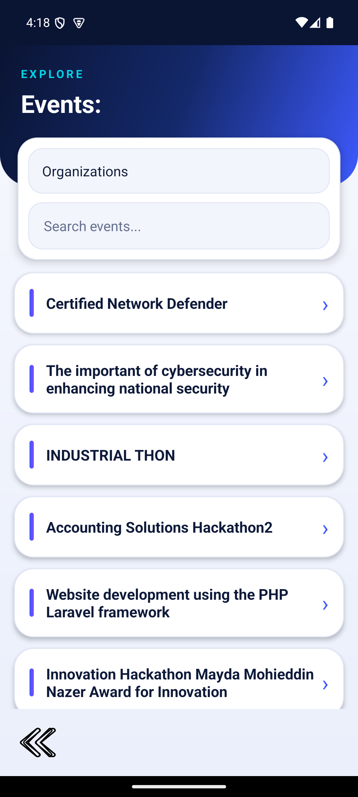
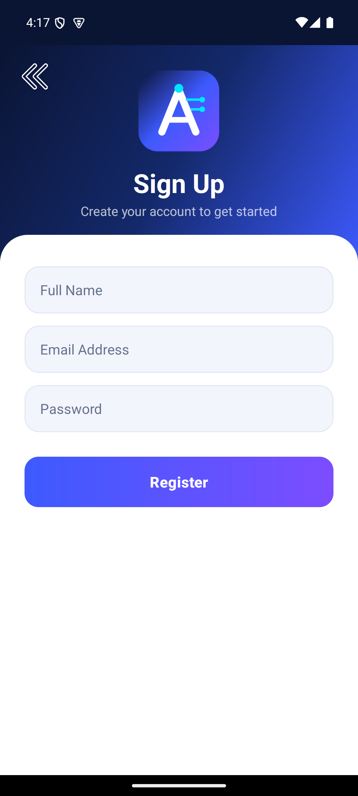

<p align="center">
  
</p>

<h1 align="center">Active Tech</h1>

<p align="center">
  Discover tech events, join communities and chat — an Android app built with Java and Firebase.<br>
  <a href="https://ritalalghates.github.io/activetech-app/"><b>▶ Live demo</b></a> ·
  <a href="https://github.com/RitalALghates/activetech-app/releases/latest/download/activetech-demo.apk"><b>⬇ Download APK</b></a>
</p>

<p align="center">
  
  
  
  
  
</p>

## Features

- **Authentication** – sign up, log in and reset password with Firebase Auth
- **Event discovery** – live events from Cloud Firestore, organization filter and instant search
- **Communities** – Cyber, Data and Software communities with text and image chat
- **Profile** – view and edit your name
- **Polished UI** – gradient hero headers, animated cards, press feedback and smooth screen transitions

## Tech stack

Java · Android SDK (min 24) · Firebase Auth / Firestore / Storage · Material Components · Glide

## Run it

1. Open the project in Android Studio and let Gradle sync.
2. Run on an emulator or device, or install the [APK](https://github.com/RitalALghates/activetech-app/releases/latest/download/activetech-demo.apk).

> The Firebase configuration (`app/google-services.json`) is included so the app works out of the box.
> Keep your Firestore / Storage security rules locked down, since the client config is public.

## Project structure

```
app/src/main/java/...   Activities, adapters, UiFx (animations)
app/src/main/res/       Layouts, drawables, theme and colors
docs/                   GitHub Pages live demo
```
